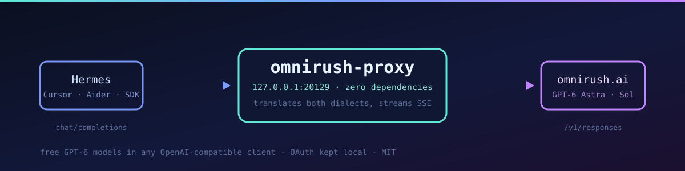

# omnirush-hermes

**Use OmniRush's free GPT-6 models — `gpt-6-astra`, `gpt-6.1-sol`, `gpt-6-sol` — from Hermes Agent, Cursor, Aider, Continue, Codex, or any OpenAI-compatible client.**

OmniRush has no public API keys: access is OAuth inside its own CLI and desktop app, and its
gateway refuses every other caller (`403 official_client_required` / `404 unsupported_model_endpoint`).
This is a **zero-dependency local proxy** that bridges your own OmniRush account into a plain
OpenAI endpoint on `127.0.0.1`, translating Chat Completions ⇄ the Responses API in both
directions — streaming, tool calls, reasoning and usage included.

[](https://github.com/KapilXSam/omnirush-hermes/actions/workflows/ci.yml)
[](LICENSE)
[](package.json)
[](#design)
[](tests/)
[](CONTRIBUTING.md)

```bash
git clone https://github.com/KapilXSam/omnirush-hermes.git ~/omnirush-proxy
cd ~/omnirush-proxy && ./install.sh          # service + Hermes provider + live verification
hermes chat -m astra                         # done
```

---

## Contents

- [Quick start](#quick-start) · [Models](#models) · [Use it in your client](#use-it-in-your-client)
- [How it works](#how-it-works) · [Verified behaviour](#verified-behaviour)
- [Configuration](#configuration) · [Endpoints](#endpoints) · [Security](#security)
- [Troubleshooting](#troubleshooting) · [FAQ](docs/FAQ.md) · [Architecture](docs/ARCHITECTURE.md)
- [Contributing](#contributing) · [Legal](#legal)

## Quick start

**Requirements:** Node ≥ 20, macOS or Linux (Windows via WSL2), and your own OmniRush account.

```bash
# 1. credentials — OmniRush's own device login (no API key exists; this is OAuth)
npm install -g omnirush2api && omnirush2api login

# 2. install: token store, background service, Hermes provider + aliases, live check
git clone https://github.com/KapilXSam/omnirush-hermes.git ~/omnirush-proxy
cd ~/omnirush-proxy && ./install.sh
```

Prefer to do it by hand? [SETUP.md](SETUP.md) is 8 steps, each with its own verification
command and an explicit "stop if this fails" gate.

**Letting an agent do it?** Paste [AGENT_PROMPT.md](AGENT_PROMPT.md) into any capable agent —
it carries the full wire recipe, the safety rules, and a required report format.

## Models

| Model | Aliases | Context | Max output | Character |
|---|---|---|---|---|
| `gpt-6-astra` | `astra`, `gpt-6`, `omnirush` | 200,000 | 16,384 | flagship deep reasoning |
| `gpt-6.1-sol` | `solpro`, `sol-pro` | 200,000 | 16,384 | frontier reasoning & coding |
| `gpt-6-sol` | `sol` | 128,000 | 8,192 | low-latency, high-throughput |

Free daily allowance comes from your OmniRush account; check it with `omnirush usage --json`.

## Use it in your client

| Client | Setup |
|---|---|
| **Hermes Agent** | `hermes chat -m astra` · `/model astra` in a session — [recipe](examples/hermes.md) |
| **Cursor** | Settings → Models → OpenAI base URL → `http://127.0.0.1:20129/v1` |
| **Continue** | `~/.continue/config.json` entry with `apiBase` — [snippet](examples/other-clients.md) |
| **Aider** | `OPENAI_API_BASE=http://127.0.0.1:20129/v1` then `--model openai/gpt-6-astra` |
| **Codex CLI** | `~/.codex/config.toml` provider block — [snippet](examples/other-clients.md) |
| **Python / Node SDK** | `base_url="http://127.0.0.1:20129/v1"`, key `sk-omnirush` |
| **Open WebUI / LibreChat** | same base URL and key, add the three model ids |

Base URL `http://127.0.0.1:20129/v1` · key `sk-omnirush` · every snippet in
[`examples/`](examples/), including [sharing it on your LAN](examples/other-clients.md#binding-beyond-localhost).

## How it works

```
Hermes · Cursor · Aider ──chat/completions──▶ omnirush-proxy ──responses (stream)──▶ omnirush.ai
       (what clients speak)                  127.0.0.1:20129     (the only thing          (GPT-6)
                                                                 the gateway answers)
```

The gateway is strict, and each rule has its own failure signature:

| Gateway rule | What a normal client sees |
|---|---|
| Only `POST /v1/responses` exists | `404 unsupported_model_endpoint` on `/chat/completions` |
| Requests must send `stream: true`, `store: false` | rejected |
| `x-omnirush-session-id` is refused unless it is the real client | `403 official_client_required` |
| The announced client version is policed | `403` — indistinguishable from the above |
| `input` must be an array of items, never a string | the request **hangs with zero bytes**, no error |

The proxy handles all five: it posts the Responses shape, sends no session id, resolves the
current official version from npm at startup (so a vendor version bump needs no code change),
and always builds `input` as items. Event-by-event mapping: [docs/ARCHITECTURE.md](docs/ARCHITECTURE.md).

### Design

One file (`src/proxy.mjs`), no runtime dependencies, no build step, no worker pool. Config is
environment variables, secrets stay in a `0600` file outside the repository, and the process is
stateless apart from the rotating OAuth token — restarting it is always safe.
The pure translation functions are exported, so they are unit-tested without a network.

## Verified behaviour

Everything below was verified against a live account before publication, not just written down.

| Check | Command | Result |
|---|---|---|
| Translation layer | `npm run test:unit` | **30 assertions pass** (no network, no credentials) |
| HTTP surface + degradation | `npm run test:integration` | **20 assertions pass** (boots the proxy for real) |
| Live end-to-end | `scripts/test-proxy.sh` | **15 assertions pass** (stream, tools, multi-turn, 401/404) |
| Hermes chat | `hermes chat -q "…HERMES_OMNIRUSH_OK" -m astra` | exact reply, ~6 s |
| Hermes tool call | `hermes chat -q "…echo TOOLCALL_WORKS" -m sol` | real tool invocation + correct answer |
| Token rotation | service log | access token refreshed, rotated refresh token persisted |

## Configuration

| Env var | Default | Purpose |
|---|---|---|
| `OMNIRUSH_PROXY_PORT` | `20129` | listen port |
| `OMNIRUSH_PROXY_KEY` | `sk-omnirush` | bearer key clients must send |
| `OMNIRUSH_PROXY_HOST` | `127.0.0.1` | bind address |
| `OMNIRUSH_GATEWAY_URL` | `https://omnirush.ai/omnirush/v1` | upstream base URL |
| `OMNIRUSH_CLIENT_VERSION` | auto (npm `omnirush@latest`) | version presented upstream |
| `OMNIRUSH_PROXY_STORE` | `~/.omnirush-proxy/tokens.json` | token store (0600) |
| `OMNIRUSH_SEED_STORE` | `~/.omnirush2api/tokens.json` | where to seed credentials from |
| `OMNIRUSH_IDLE_TIMEOUT_MS` | `180000` | abort a stalled upstream stream |

See [`.env.example`](.env.example).

## Endpoints

| Route | Purpose |
|---|---|
| `POST /v1/chat/completions` | OpenAI Chat Completions — streaming and non-streaming |
| `POST /v1/responses` | raw passthrough for Responses-native clients |
| `GET /v1/models` | the three models, with context and max-output metadata |
| `GET /v1/health` | account, client version, model list, liveness |

## Managing the service

```bash
scripts/ctl.sh status      # pid + live health (account, models, client version)
scripts/ctl.sh logs        # tail the service log
scripts/ctl.sh restart
scripts/ctl.sh test        # 15 live assertions
scripts/ctl.sh reauth      # re-run the OmniRush login, refresh the store, restart
./uninstall.sh [--purge]   # remove the service, provider and aliases
```

## Security

- **No credentials in this repository.** Tokens live only in `~/.omnirush-proxy/tokens.json`
  (mode 600, outside the project); `.gitignore`, a dependency-free scanner over the tree **and
  full git history**, gitleaks in CI, and `scripts/publish.sh`'s pre-publish gates all enforce it.
- Clients authenticate with a **local dummy key** (`sk-omnirush`); the real OAuth bearer never
  leaves the proxy process.
- The proxy binds loopback only and has no TLS. If you expose it, change the key — see
  [SECURITY.md](SECURITY.md).

## Troubleshooting

| Symptom | Fix |
|---|---|
| `403 official_client_required` | vendor bumped the accepted version — `npm view omnirush version`, set `OMNIRUSH_CLIENT_VERSION`, restart |
| `401` from upstream | refresh token rotated away — `scripts/ctl.sh reauth` |
| Hang, zero bytes | body shape — `input` must be an array of items, `stream:true`, `store:false` |
| Health `unhealthy`, `account_count: 0` | no credentials — redo the login, then `scripts/ctl.sh reauth` |
| `EADDRINUSE :20129` | a stale proxy holds the port — `lsof -nP -iTCP:20129 -sTCP:LISTEN` |
| Intermittent 401s | two processes sharing one rotating token store — run exactly one |

Full list, with causes and commands: [docs/FAQ.md](docs/FAQ.md).

## Development

```bash
npm test               # 30 unit + 20 integration assertions, no network, no credentials
npm run lint           # JS + shell syntax
npm run scan           # secret gate over the tree and full git history
npm run publish:check  # every pre-publish gate, changes nothing
```

CI runs gitleaks, the pattern scan, syntax checks, the test matrix on Node 20/22/24 plus macOS,
and a package-integrity job that fails if a token store, `.env`, or a runtime dependency ever
sneaks in.

## Maintenance

OmniRush hardens its gateway periodically. The proxy resolves the current official client
version from npm at startup, so version bumps normally need no action. If the vendor changes
the wire protocol, the symptom to look for in the log is `403 official_client_required` —
see [Troubleshooting](#troubleshooting) and [docs/FAQ.md](docs/FAQ.md).

## Contributing

Bug reports, client compatibility reports and docs fixes are all welcome — see
[CONTRIBUTING.md](CONTRIBUTING.md) and the [Code of Conduct](CODE_OF_CONDUCT.md). Security
issues go through a [private advisory](SECURITY.md), never a public issue.
Changes are logged in [CHANGELOG.md](CHANGELOG.md).
Agents working in this repo should read [AGENTS.md](AGENTS.md).

## Legal

Independent interoperability tool. **Not affiliated with, endorsed by, or maintained by
OmniRush.ai.** "OmniRush" and its model names are trademarks of their respective owners. It
presents itself to the upstream gateway as the official client because that gateway refuses
anything else, which may conflict with OmniRush's terms — use it only with your own account and
at your own risk. MIT licensed ([LICENSE](LICENSE)).
